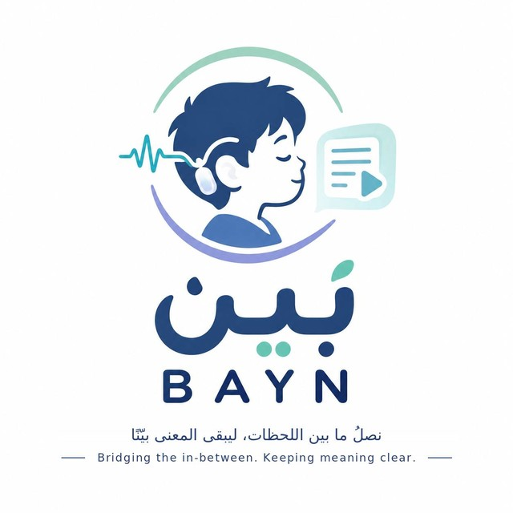
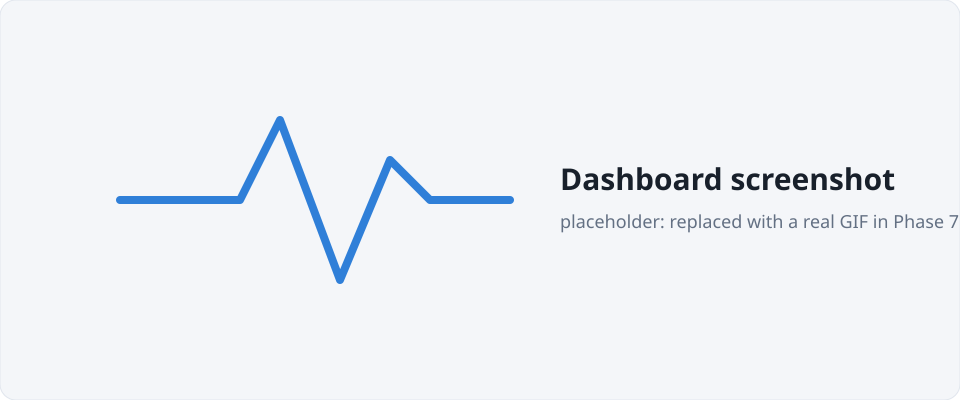
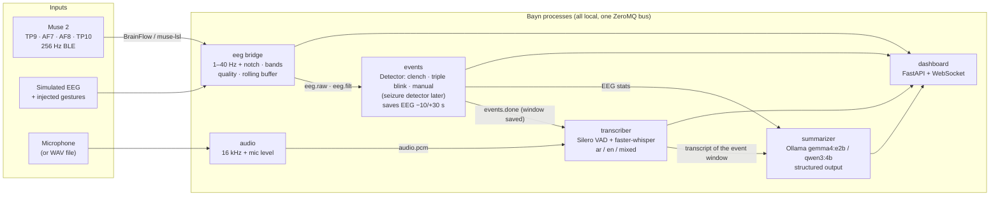

<p align="center">
  
</p>

<h1 align="center">Bayn · بيّن</h1>

<p align="center">
  <b>Bridging the in-between. Keeping meaning clear.</b><br>
  <span dir="rtl" lang="ar">نصلُ ما بين اللحظات، ليبقى المعنى بيّنًا</span>
</p>

**A deliberate gesture on a Muse 2 headband starts a local pipeline: the event is tagged, the EEG around it is saved, live speech is transcribed with Whisper, and a small local LLM writes a short summary. Everything runs 100% offline.**

> [!WARNING]
> **Prototype for a hackathon demo. Not a medical device.** It does not detect seizures or any medical condition, and it must not be used for diagnosis, monitoring or treatment.


<!-- TODO(Phase 7): replace with a real screenshot / GIF of the demo -->

## Status

| Phase | Scope | State |
|---|---|---|
| 1 | Repo, simulated EEG, dashboard skeleton | ✅ done |
| 2 | Real Muse 2 (BrainFlow, muse-lsl fallback) | ✅ done |
| 3 | Gesture trigger (jaw clench / double blink), calibration, events | ✅ done (double blink on real headset → ML in Phase 6) |
| 4 | Live Whisper transcription (English / Arabic / mixed) | ✅ done |
| 5 | Local LLM summaries (Ollama), shown live: heard → context → summary | ✅ done |
| 5b | Model benchmark: Whisper × LLM on recorded English / Arabic / mixed speech, GPU and minimal CPU ([results](docs/BENCHMARK.md)) | ✅ dev PC · ⏳ re-test on the demo laptop |
| 6 | Triple-blink trigger, EEG only: learned blink pattern + rule; decision test showed ML isn't needed ([BLINK_DECISION.md](docs/BLINK_DECISION.md)) | ✅ done (user demo test) |
| 7 | Setup & packaging polish (one-command setup, offline readiness, laptop checklist), docs | ⬜ |
| 8 | Full end-to-end test run (simulated and real) | ⬜ |

Details per phase: [docs/PROGRESS.md](docs/PROGRESS.md). How everything is tested, with results: [docs/TESTING.md](docs/TESTING.md).

## How it works



- **One message bus (ZeroMQ, TCP).** Every component is a separate process: a crash in one (e.g. the transcriber) doesn't take down the others. Everything runs natively, because Bluetooth, the microphone and the GPU all live on the host.
- **The trigger sits behind a `Detector` interface.** The jaw clench, the triple blink, the manual button/hotkey and a future seizure model are interchangeable ([seizure_stub.py](src/bayn/events/detectors/seizure_stub.py) shows where a model plugs in).
- **No hardware assumptions.** The mains notch defaults to `auto` (measures 50 vs 60 Hz). Whisper picks GPU or CPU at startup.
- **Brainwave view, like the Muse app.** Live delta / theta / alpha / beta / gamma per sensor, e.g. *Alpha (AF7)*. Close your eyes and watch alpha rise on TP9/TP10.

## Quickstart

Requires **Python 3.12+**. No headset is needed for the demo. A microphone is optional (`--audio file` plays a sample clip instead).

### Windows (PowerShell)
```powershell
.\bayn setup     # .venv + pinned deps (+ CUDA libs if NVIDIA GPU), Whisper models, machine check
.\bayn demo      # simulated EEG + scripted gestures + live mic, opens http://127.0.0.1:8080
.\bayn check     # with the headset on: 10 s connection + signal-quality test
.\bayn run       # real Muse 2 (default source) + mic + dashboard
.\bayn demo --audio file    # no microphone: plays samples/audio/demo.wav (English + Arabic)
```
Setup also installs **Ollama** (local LLM runtime, via winget on Windows) and downloads the models once: about **7 GB** with an NVIDIA GPU (Whisper large-v3-turbo + CUDA libraries + gemma4:e2b), about **5 GB** without one (Whisper small + gemma4:e2b; qwen3:4b below 7 GB RAM). After that everything runs offline.
`bayn.cmd` works even though Windows blocks PowerShell scripts by default. It bypasses the policy for that one call only, and nothing on your system changes.

### macOS / Linux
```bash
make setup
make demo
```

### Without the helpers
```bash
python -m venv .venv && . .venv/bin/activate      # Windows: .venv\Scripts\activate
pip install -r requirements/dev.txt && pip install -e . --no-deps
python -m bayn.run --demo
```

Other commands: `test`, `doctor` (check a machine before a demo: Bluetooth, Muse, Whisper model, GPU, microphone, Ollama + summary model), `models` (download Whisper + summary models), `eval-summary` (score summary models), `record` / `eval-stt` (score transcription on your own recordings), `benchmark` (Whisper × LLM on the recorded corpus, [BENCHMARK.md](docs/BENCHMARK.md)), `mics` (list microphones), `sample-audio` (regenerate the demo WAVs), `bridge`, `ui`, `clean`.

## Firing an event

| Trigger | How | Notes |
|---|---|---|
| **Jaw clench** (default) | Clench firmly and hold for about 1 s | Muscle activity on the sensors behind the ears (TP9/TP10). Talking or swallowing is too short to fire. |
| **Triple blink** | Three firm blinks at a steady pace (~2 per second, each within 0.8 s of the last) | A single, double or four-fold blink doesn't fire (`events.triple_blink.count` sets the number). On the Muse, blinks show up mostly on the **ear sensors** (TP9/TP10), because its reference electrode sits on the forehead. Record a few labelled sessions (Blink detector → Train…) so Bayn learns *your* blink pattern; the rule then counts blinks on that pattern. A machine-learning classifier was tested and isn't needed ([decision](docs/BLINK_DECISION.md)). Keep your head still: nodding is the main false trigger. |
| **Button / `T` key** | "Trigger event" in the dashboard | Always available as a backup. |

Pick the gesture in the dashboard's **Event trigger** card (or `events.gesture` in the config). Then press **Calibrate…** once per person: 15 s of rest, then 3 prompted repetitions. The thresholds are saved per user, in `data/profiles/`. After an event, further gestures are ignored for a 15 s cooldown.

Each event:
- flashes a banner, marks the plot, and beeps (turn sound on with 🔔)
- saves the EEG from **10 s before to 30 s after** to `data/events/<id>/` as `eeg.csv`, `eeg.npz` and `meta.json` (with before/after brainwave stats). The files are downloadable from the timeline.
- gets the **transcript of its window** attached (`transcript.txt` / `.json`, times relative to the event), which feeds the summary (Phase 5)

## Live transcription

Bayn transcribes the microphone **continuously**, so speech from *before* an event is captured too. Every segment is timestamped in the same clock as the EEG.

| | |
|---|---|
| **Speech detection** | Silero VAD cuts the stream into utterances (a 0.6 s pause ends one) |
| **Model** | `auto`: **large-v3-turbo** on an NVIDIA GPU (float16), **small** on CPU (int8). If the GPU fails it falls back to CPU automatically. Override with `transcription.model` |
| **Languages** | `mixed` (default): each utterance is detected as **Arabic or English**, so you can switch mid-conversation. Also `en`, `ar`, or `auto` (any language). Switch live in the dashboard |
| **Display** | Arabic shown right-to-left, with language tag and time per segment. Live in-progress text on GPU. Segments inside an event window are highlighted |
| **Speed** | Dev PC, RTX 2080 Ti: text **~1.3 s after you stop speaking**. Demo laptop (i7-1355U, 8 GB, no GPU, `small`): **~3–8 s per utterance, text 6–10 s after you stop speaking** – usable, not instant. On the CPU, `mixed` mode runs Whisper's encoder once per utterance instead of twice (`transcription.single_encode: auto`), 26–48 % faster with identical text |

**Current limitations** (measured on a live mic, see [TESTING.md](docs/TESTING.md) F2):

| Speech | Word error rate |
|---|---|
| English | **1.2 %**, essentially verbatim |
| Arabic (Hejazi dialect) | **28.8 %** (12 % CER), readable; dialect words are sometimes misspelled |
| Switching language **inside** a sentence | **≈ 40 %**. When a sentence is decoded as English, its Arabic words can be translated or transliterated |

Switching between sentences works well. With English key terms inside Arabic speech, Whisper usually **hears** them but writes them **in Arabic letters** (nucleus → النيوكليوس). The summary model still understands most of them.

**Model benchmark:** [docs/BENCHMARK.md](docs/BENCHMARK.md) compares 6 Whisper models × 11 summary LLMs on recordings of the corpus, on a GPU and on a 4-thread CPU (a minimal laptop). [docs/CORPUS.md](docs/CORPUS.md) has the 12 short scripts: the same 4 topics in English, Arabic and mixed (Arabic with English key terms). Record each once with `.\bayn record <id>`, then run `.\bayn benchmark` (or `.\bayn eval-stt --corpus all` for transcription strategies). Current numbers are from the dev PC; the demo configuration is re-tested on the demo laptop.

Pick a microphone with `BAYN_AUDIO__DEVICE=<part of its name>` (see `.\bayn mics`). With no mic, `--audio file` plays [samples/audio/demo.wav](samples/audio/demo.wav), a fictional English/Arabic narration generated with Windows' offline text-to-speech from [demo_script.json](samples/audio/demo_script.json).

## Summaries

When an event's window closes, the transcript of that window is summarised by a **local LLM through Ollama**. The dashboard shows each step side by side:

**① Heard** (the transcript, with times relative to the event) → **② Context** (EEG description + the exact prompt sent to the model) → **③ Summary**, written live as the model generates it.

| | |
|---|---|
| **Model** | `auto`: **gemma4:e2b** with an NVIDIA GPU of ≥ 6 GB, Apple Silicon, no NVIDIA GPU and ≥ 7 GB RAM (8 GB laptops), or a smaller NVIDIA GPU and ≥ 12 GB RAM; else **qwen3:4b**. Chosen with the model benchmark on the [dev PC](docs/BENCHMARK.md) and the [demo laptop](docs/BENCHMARK_LAPTOP.md). Any Ollama model via `summary.model` |
| **Language** | `auto` = main language of the speech · `en` · `ar` · `both`. Switch in the dashboard. Arabic prompts are written in Arabic |
| **Format** | Structured output (summary, ≤ 4 key points with times, unclear words), rendered by code, so the format holds in every language |
| **EEG part** | Written **by code**, not the LLM: dominant rhythm before → after and signal quality per sensor, labelled "not a medical assessment" |
| **Speed** | Dev PC, RTX 2080 Ti: ~1.6 s per summary (gemma4:e2b). Demo laptop (CPU only, 8 GB): **~20–28 s** per summary with gemma4:e2b (qwen3:4b: ~35 s and fewer facts) |
| **Saved** | `data/events/<id>/summary.md` + `summary.json`, downloadable from the timeline. ↻ regenerates |

Quality is measured on real transcripts of recorded speech, recognition errors included ([BENCHMARK.md](docs/BENCHMARK.md), [TESTING.md](docs/TESTING.md)). With Whisper large-v3-turbo, gemma4:e2b covers **81 %** of the key facts (82 % for mixed speech), and its incident summaries contain **no diagnoses**. Summaries can still miss details or embellish slightly. They are always marked as generated from an automatic transcript.

## Disk space and the demo laptop

Everything big lives inside this folder, in `models/` (gitignored), so it never fills a small C: drive and can be **copied to another machine**:

| Folder | What | Size |
|---|---|---|
| `models/whisper/` | Whisper speech models (large-v3-turbo 1.5 GB, small 0.5 GB, tiny 75 MB) | ~2 GB |
| `models/ollama/` | Summary LLMs (gemma4:e2b 4.3 GB on disk incl. its unused image/audio parts, qwen3:4b 2.5 GB) | ~7 GB |
| `.venv/` | Python packages incl. CUDA libraries (NVIDIA only) | ~2.6 GB |

`bayn setup` points Ollama to `models/ollama` through the `OLLAMA_MODELS` user variable, unless you already chose a folder. It also switches off Ollama's cloud features (`OLLAMA_NO_CLOUD=1`). `doctor` shows each folder's size and the free space on its drive, and warns below 5 GB. **For the laptop:** copy the `models/` folder over before running setup, and the downloads are skipped. A CPU-only laptop needs only Whisper `small` plus the summary model `auto` picks there (`bayn models` pulls just that one). The benchmark candidates on the dev PC take much more space and don't need copying. `bayn run` starts Ollama by itself if it isn't running.

### Running on a modest laptop (CPU only, 8 GB RAM)

Measured on the demo laptop (ASUS Vivobook 15, i7-1355U, 8 GB, no NVIDIA GPU; [BENCHMARK_LAPTOP.md](docs/BENCHMARK_LAPTOP.md)). `auto` already picks the right setup there: Whisper **small** on the CPU with one encoder pass per utterance, summaries by **gemma4:e2b**. What matters is **memory**:

- **Close everything else** (IDE, Chrome, Steam, Teams…). With Bayn and gemma4:e2b loaded, an 8 GB machine has little to spare; when Windows starts swapping, the transcript falls 10–35 s behind.
- Start from a terminal with `.ayn run --no-browser` and open http://127.0.0.1:8080 in one light browser tab (e.g. Edge).
- **Wait ~30 s** after start (the summary model loads from disk) before speaking, and switch the Muse on **before** starting, so it connects quickly.
- Expect text **6–10 s** after you stop speaking and a summary **~30 s** after an event window closes.

## Configuration

Settings live in [config/default.yaml](config/default.yaml). Override them per machine with `config/local.yaml` (gitignored) or with environment variables / `.env`:

```
BAYN_EEG__SOURCE=muse           # muse | lsl | sim
BAYN_EEG__NOTCH_HZ=auto         # auto | 50 | 60 | off
BAYN_UI__PORT=8080
```

## Muse 2 pairing notes

Two ways to read the headset, both tested with a real Muse 2:

| Source | How | When |
|---|---|---|
| `muse` (default) | BrainFlow `MUSE_2_BOARD`, native Bluetooth LE | Normal use. No extra process |
| `lsl` | `muselsl stream` → Lab Streaming Layer → Bayn | Fallback if BrainFlow misbehaves. `run --source lsl` starts and restarts `muselsl` for you |

**Connecting**
1. **Do not pair the Muse in your OS Bluetooth settings.** If it is already paired there, remove it. Both sources find and connect to the headset directly.
2. Turn the headset on. The lights should be moving, which means it is waiting for a connection.
3. **Close the Muse phone app** (or turn off phone Bluetooth). The Muse accepts only one connection at a time, and while the app is connected the headset is invisible to the computer.
4. Wet the sensors slightly (forehead and behind the ears). Then run `check`: every channel should be `good`.
5. When several Muses are nearby (hackathon!), pin yours by name: `BAYN_EEG__BRAINFLOW__SERIAL_NUMBER=Muse-XXXX` in `.env`. The name is printed by `doctor` and its last 4 characters match the headset's MAC.

**Troubleshooting**
- **`doctor` sees no Muse / very few BLE devices:** the Bluetooth radio has poor reception. Desktop Wi-Fi/Bluetooth cards need their screw-on antennas. A USB Bluetooth dongle fixes it.
- **A USB dongle shows "Code 31" in Device Manager on Windows 10:** many cheap dongles (e.g. Actions ATS2851 chips) only work out of the box on Windows 11 and need the vendor's driver on Windows 10. Realtek RTL8761B dongles (TP-Link UB500, ASUS USB-BT500) work out of the box. Keep only one Bluetooth adapter enabled.
- **Connected but a channel is `bad`:** adjust the band so the ear sensors (TP9/TP10) touch skin, and move hair from under the forehead sensors.
- **Mains hum:** handled automatically. The notch removes 50 and 60 Hz and the header shows which one your power grid uses.

## Project layout

```
config/          default.yaml (all tunables)
src/bayn/
  common/        config, ZeroMQ bus, message schemas
  eeg/           sources (simulated, Muse via BrainFlow / LSL), filters, ring buffer, quality,
                 brainwave bands, bridge, check (headset test)
  events/        Detector interface, clench / triple-blink (rule + ML) / manual detectors, seizure stub,
                 calibration, event manager (cooldown, EEG windows), SQLite store, service
  transcription/ audio capture (mic / WAV), VAD segmenter, Whisper engine, transcript store,
                 service (attaches transcripts to events), model downloader
  summarization/ Ollama client, prompts (en/ar), structured rendering, quality checks,
                 model choice, service, evaluation tool
  ui/            FastAPI server + static dashboard (no CDN, works offline)
  run.py         one-command launcher     doctor.py  machine check
scripts/         bayn.ps1 (Windows tasks), claude-session.ps1
tests/           pytest suite: unit / integration / system (no hardware) + hardware (real Muse)
docs/            PROGRESS.md (phase log), TESTING.md (test plan + results), images
```

## Testing

```powershell
.\bayn test                                               # unit + integration + system, no hardware (~20 s)
$env:BAYN_HARDWARE=1; .\.venv\Scripts\python.exe -m pytest -m hardware -v -s   # with the Muse on
```
Tests are grouped into `unit`, `integration`, `system` and `hardware` markers. See [docs/TESTING.md](docs/TESTING.md) for the full test plan, per-phase results, the requirements traceability matrix and the defect log.

## Privacy

Everything runs locally. No cloud APIs and no analytics. Whisper weights are downloaded **once** by `setup` / `bayn models` into `models/` and then loaded from disk only (`local_files_only`). Hugging Face telemetry is disabled. The LLM runs in a **local** Ollama server (`127.0.0.1:11434`; `doctor` warns if it's pointed elsewhere). After setup, the system runs with the network unplugged. Audio is never stored as sound, only as transcript text in `data/`.

## License

[MIT](LICENSE)
