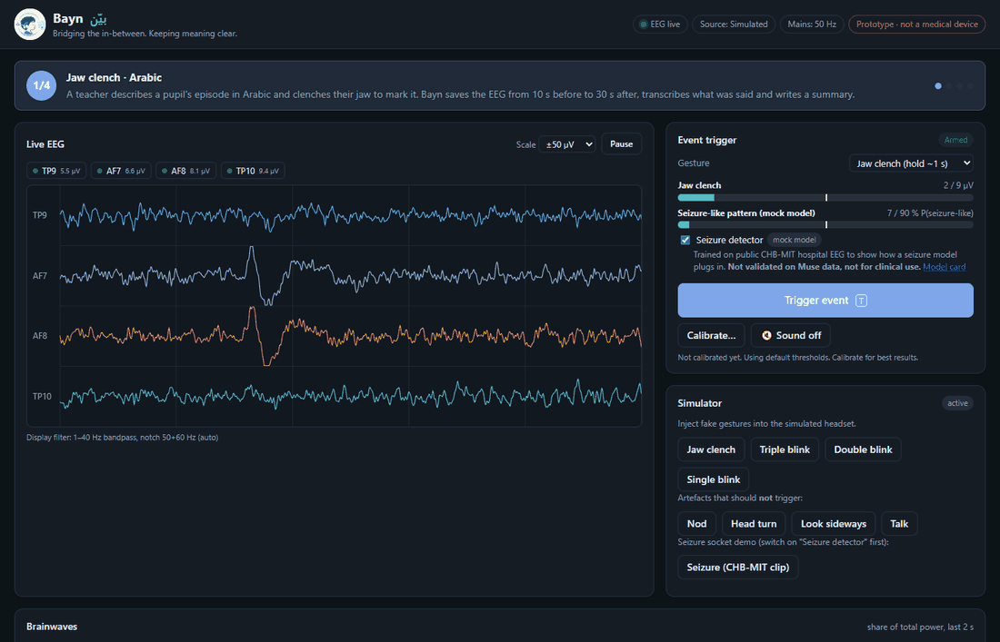
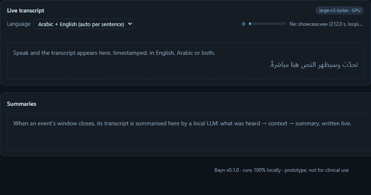
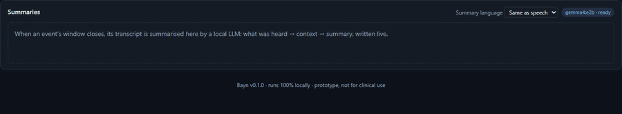
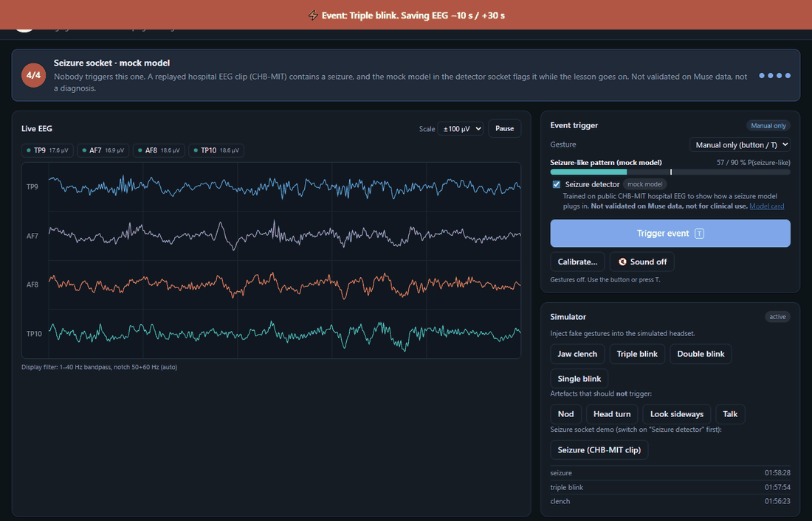
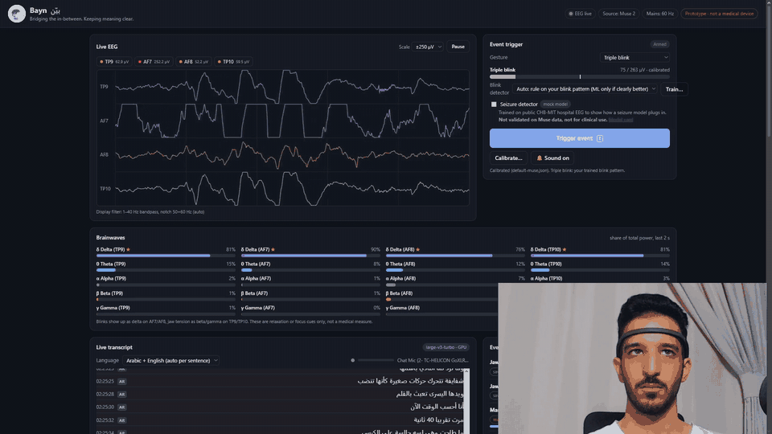
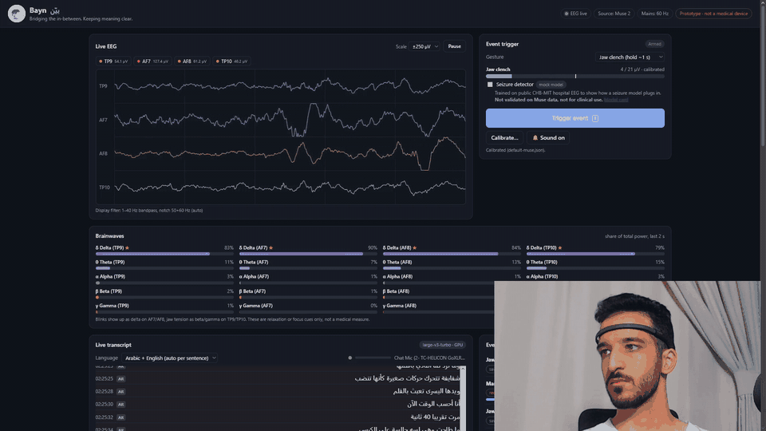
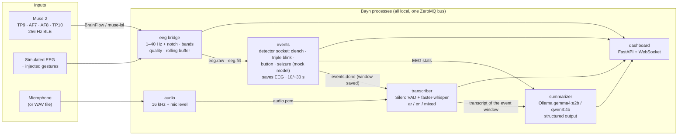

<p align="center">
  
</p>

<h1 align="center">Bayn · بيّن</h1>

<p align="center">
  <b>Bridging the in-between. Keeping meaning clear.</b><br>
  <span dir="rtl" lang="ar">نصلُ ما بين اللحظات، ليبقى المعنى بيّنًا</span>
</p>

**An EEG headband marks a moment; Bayn saves the brain signal around it, transcribes what was said (Arabic, English or both) and writes a short summary, all on the local machine, with no internet.**

> [!WARNING]
> **Prototype for a hackathon demo. Not a medical device.** It must not be used for diagnosis, monitoring or treatment. The included seizure detector is a *mock* model trained on public hospital EEG to show how such a model would plug in; it is not validated on Muse data.



## About

**The problem.** *Absence seizures* are brief lapses of awareness, often only a few seconds of staring, that are
common in school-age children and easy to miss or mistake for daydreaming. The adults around the child, a teacher or a
parent, are often the only witnesses, and what they noticed is hard to recall accurately later.

**The idea.** A comfortable EEG headband detects such an episode, and Bayn captures the moment: the EEG from 10 s
before to 30 s after, a live transcript of what the people nearby said (in Arabic, English, or a mix of both), and a
short structured summary they can pass on to a parent or doctor. Everything runs offline on a laptop, so no recording
leaves the room.

**What this prototype does today.** Automatic detection of absence seizures on a consumer headband is not something a
hackathon can build or validate. So, **for development and testing, events are triggered deliberately**:

- a **jaw clench**,
- a **triple blink**,
- or a **button / the `T` key**.

That lets the whole pipeline be built, tested and demonstrated on demand with a consumer Muse 2 headband. Each trigger
is a `Detector` behind one interface, the "detector socket". A seizure model plugs into the same socket, and its
alarms then follow exactly the same path as a gesture.

**The seizure socket is filled with a mock model**, to show that path working end to end. It is a small logistic
regression trained on the public [CHB-MIT Scalp EEG Database](https://physionet.org/content/chbmit/1.0.0/)
(PhysioNet, Boston Children's Hospital; 8 children, 47 h, 28 seizures), with four Muse-like channels approximated from
the hospital electrodes. It is **not** an absence-seizure detector and **not** validated on Muse data
([model card](docs/SEIZURE_MODEL.md)). A real absence-seizure model, trained and validated on the target headset,
would replace it without changing anything else.

## Try it (judges)

**1. Look first, nothing to install.** The GIFs below come from a recording of `bayn showcase`. The whole recorded
dashboard replays in your browser: open [`docs/preview/index.html`](docs/preview/index.html) after cloning (or
downloading the repo as a ZIP).

**2. Run it yourself, no headset or microphone needed** (Windows; macOS/Linux: `make setup` / `make showcase`):
```powershell
git clone https://github.com/Omar0Rawas/bayn.git
cd bayn
.\bayn setup        # once: Python packages + Whisper + Ollama and a small local LLM (5-7 GB), then fully offline
.\bayn showcase     # opens http://127.0.0.1:8080 and plays a 3.5-minute guided tour, on a loop
```
The showcase uses simulated EEG and recorded speech (a team member reading fictional scripts through the demo's
wireless mic). Everything else is real and runs on your machine: the detectors, the saved EEG windows, live Whisper
transcription and the local LLM summaries. Each scene fires one trigger:

| Scene | Trigger | Speech | What to watch |
|---|---|---|---|
| 1 | **Jaw clench** | Arabic | the clench burst on the EEG, the event, then an Arabic summary |
| 2 | **Button** (or the `T` key) | English | the same pipeline without a gesture |
| 3 | **Triple blink** | Arabic with English terms | each sentence is transcribed in its own language |
| 4 | **Seizure detector** (mock model) | English lesson | nobody triggers it: a replayed hospital EEG seizure (CHB-MIT) raises an automatic event |

**3. Check the claims.** `.\bayn test` runs 239 tests without hardware (about 4 minutes). The [documentation](#documentation)
has the test results, the measurements on the demo laptop and the model cards.

**4. With a Muse 2 and a microphone:** `.\bayn run`, choose the trigger in **Event trigger**, press **Calibrate…** once
(about a minute), then clench, blink three times or press `T` while someone talks.

| Live transcript (Arabic) | Summary written locally |
|---|---|
|  |  |

| Seizure socket (mock model) |
|---|
|  |

**On a real Muse 2** (the dashboard with a webcam in the corner, recorded live):

*Triple blink:* three firm blinks show up as three large waves on the ear sensors (TP9/TP10), and the event fires.



*Jaw clench:* clenching for about a second makes a burst of fast muscle activity, clearest on the ear sensors (TP9/TP10), and the event fires.



## How it works



- **One message bus (ZeroMQ, TCP).** Every component is a separate process, so a crash in one (e.g. the transcriber) doesn't take down the others. Everything runs natively, because Bluetooth, the microphone and the GPU all live on the host.
- **Every trigger sits behind the `Detector` interface** ([base.py](src/bayn/events/detectors/base.py)). [seizure_model.py](src/bayn/events/detectors/seizure_model.py) shows how a model plugs in.
- **No hardware assumptions.** The mains notch defaults to `auto` (it measures 50 vs 60 Hz). Whisper and the summary model are picked for the machine at startup (GPU or CPU, RAM).
- **Brainwave view, like the Muse app.** Live delta / theta / alpha / beta / gamma per sensor, e.g. *Alpha (AF7)*. Close your eyes and watch alpha rise on TP9/TP10.

## Built with

All of it is open source and runs locally. Exact versions are pinned in [requirements/](requirements/).

| Area | Libraries |
|---|---|
| EEG | [BrainFlow](https://brainflow.org) (Muse 2 over Bluetooth LE), [muselsl](https://github.com/alexandrebarachant/muse-lsl) + [pylsl](https://github.com/labstreaminglayer/pylsl) (fallback via Lab Streaming Layer), [NumPy](https://numpy.org), [SciPy](https://scipy.org) (filters, spectra) |
| Speech | [faster-whisper](https://github.com/SYSTRAN/faster-whisper) on [CTranslate2](https://github.com/OpenNMT/CTranslate2), Silero VAD (bundled with faster-whisper, via [ONNX Runtime](https://onnxruntime.ai)), [sounddevice](https://python-sounddevice.readthedocs.io) (microphone) |
| Summaries | [Ollama](https://ollama.com) (local LLM server), [httpx](https://www.python-httpx.org) |
| Machine learning | [scikit-learn](https://scikit-learn.org) (mock seizure model training, blink-classifier evaluation), [joblib](https://joblib.readthedocs.io) |
| Plumbing and UI | [pyzmq](https://pyzmq.readthedocs.io) + [msgpack](https://msgpack.org) (message bus), [FastAPI](https://fastapi.tiangolo.com) + [Uvicorn](https://www.uvicorn.org) + [websockets](https://websockets.readthedocs.io) (dashboard), [Pydantic](https://docs.pydantic.dev) + [PyYAML](https://pyyaml.org) (config), plain HTML/CSS/JS with no CDN, [pytest](https://pytest.org) |

| Model | Used for | Where it runs |
|---|---|---|
| **Whisper large-v3-turbo** (OpenAI, CTranslate2 conversion) | transcription with an NVIDIA GPU | GPU, float16 |
| **Whisper small** (OpenAI, CTranslate2 conversion) | transcription without a GPU (the demo laptop) | CPU, int8 |
| Whisper tiny | the test suite only | CPU |
| **Silero VAD** | cutting the audio stream into utterances | CPU |
| **Gemma 4 E2B** (`gemma4:e2b`, Google) | summaries: the default on most machines | Ollama, GPU or CPU |
| **Qwen3 4B** (`qwen3:4b`, Alibaba) | summaries on machines with little RAM | Ollama |
| **Mock seizure model** (logistic regression, trained here on CHB-MIT) | the seizure socket | CPU, 14 coefficients ([model card](docs/SEIZURE_MODEL.md)) |
| **Triple-blink rule** on a learned blink pattern (no ML: [decision](docs/BLINK_DECISION.md)) | the triple-blink trigger | CPU |

The Whisper and summary models were chosen with a benchmark of 6 Whisper models × 11 local LLMs on recorded
English, Arabic and mixed speech, on the development PC and on the demo laptop ([BENCHMARK.md](docs/BENCHMARK.md),
[BENCHMARK_LAPTOP.md](docs/BENCHMARK_LAPTOP.md)). Each model is used under its own licence.

**Data:** CHB-MIT Scalp EEG Database (Guttag, 2010; PhysioNet, [doi:10.13026/C2K01R](https://doi.org/10.13026/C2K01R),
Open Data Commons Attribution License v1.0) for the mock seizure model and its demo clip. Speech recordings: the
team's own readings of fictional scripts ([CORPUS.md](docs/CORPUS.md)).

## Quickstart

Requires **Python 3.12+**. No headset is needed for the demo. A microphone is optional (`--audio file` plays a sample clip instead).

### Windows (PowerShell)
```powershell
.\bayn setup     # .venv + pinned deps (+ CUDA libs if NVIDIA GPU), Whisper models, machine check
.\bayn showcase  # guided tour, no headset and no microphone (see "Try it" above)
.\bayn demo      # simulated EEG + scripted gestures + live mic, opens http://127.0.0.1:8080
.\bayn demo --audio file    # no microphone: plays samples/audio/demo.wav (English + Arabic)
.\bayn check     # with the headset on: 10 s connection + signal-quality test
.\bayn run       # real Muse 2 (default source) + mic + dashboard
```
Setup also installs **Ollama** (local LLM runtime, via winget on Windows) and downloads the models once: about **7 GB** with an NVIDIA GPU (Whisper large-v3-turbo + CUDA libraries + gemma4:e2b), about **5 GB** without one (Whisper small + gemma4:e2b; qwen3:4b below 7 GB RAM). After that everything runs offline.
`bayn.cmd` works even though Windows blocks PowerShell scripts by default. It bypasses the policy for that one call only, and nothing on your system changes.

### macOS / Linux
```bash
make setup
make showcase    # or: make demo
```

### Without the helpers
```bash
python -m venv .venv && . .venv/bin/activate      # Windows: .venv\Scripts\activate
pip install -r requirements/dev.txt && pip install -e . --no-deps
python -m bayn.run --showcase
```

Other commands: `test`, `doctor` (check a machine before a demo: Bluetooth, Muse, Whisper model, GPU, microphone, Ollama + summary model), `models` (download Whisper + summary models), `eval-summary` (score summary models), `record` / `eval-stt` (score transcription on your own recordings), `benchmark` (Whisper × LLM on the recorded corpus), `blink` (blink-detector checks), `mics` (list microphones), `sample-audio` (regenerate the demo WAVs), `bridge`, `ui`, `clean`.

## Triggers

| Trigger | How | Notes |
|---|---|---|
| **Jaw clench** (default) | Clench firmly and hold for about 1 s | Muscle activity on the sensors behind the ears (TP9/TP10). Talking or swallowing is too short to fire. |
| **Triple blink** | Three firm blinks at a steady pace (~2 per second, each within 0.8 s of the last) | A single, double or four-fold blink doesn't fire. On the Muse, blinks show up mostly on the **ear sensors** (TP9/TP10), because its reference electrode sits on the forehead. Works out of the box with a **built-in Muse blink pattern**; **Calibrate…** (about a minute) learns *your* pattern and catches about as many triple blinks as half an hour of recorded training (66 % vs 67 % of prompts on held-out real sessions; 0.5 vs 0.3 false triggers per minute). A machine-learning classifier was tested and isn't needed ([decision](docs/BLINK_DECISION.md)). Keep your head still: nodding is the main false trigger. |
| **Button / `T` key** | "Trigger event" in the dashboard | Always available as a backup. |
| **Seizure detector** (mock model, off by default) | Automatic | Shows how a seizure model plugs into the same socket ([below](#seizure-detector-socket-mock-model)). |

Pick the trigger in the dashboard's **Event trigger** card (or `events.gesture` in the config), then press **Calibrate…** once per person: 15 s of rest, then 3 prompted repetitions. Settings are saved per user in `data/profiles/`. After an event, further gestures are ignored for a 15 s cooldown (a seizure alarm never is).

Each event:
- flashes a banner, marks the plot, and beeps (turn sound on with 🔔)
- saves the EEG from **10 s before to 30 s after** to `data/events/<id>/` as `eeg.csv`, `eeg.npz` and `meta.json` (with before/after brainwave stats), downloadable from the timeline
- gets the **transcript of its window** attached (`transcript.txt` / `.json`, times relative to the event), which feeds the summary

## Seizure-detector socket (mock model)

> [!WARNING]
> **Not validated on Muse data. Not an absence-seizure detector. Not a medical device. Not for any clinical use.**

- **Trained on public hospital EEG:** the [CHB-MIT Scalp EEG Database](https://physionet.org/content/chbmit/1.0.0/)
  (PhysioNet, ODC-By 1.0), 8 children, 47 h, 28 seizures. Four Muse-like channels are approximated from the hospital
  montage. CHB-MIT doesn't label seizure types and wasn't collected for absence seizures.
- **A small, transparent model:** a logistic regression with 14 coefficients, on features that compare each 4 s of EEG
  with the person's own last few minutes (power, line length, rhythm, synchrony).
- **Scored honestly, on CHB-MIT only:** each patient is held out in turn. It detects 21/28 seizures, a median 20 s
  after onset, with 3.6 false alarms per hour. It has **never** been tested on Muse recordings.
- **Details:** the [model card](docs/SEIZURE_MODEL.md) covers the data, the evaluation and how to reproduce it
  (`python -m bayn.seizure.chbmit download`, then `python -m bayn.seizure.train --clip`).

Try it without a headset: `.\bayn showcase` (scene 4), or `.\bayn demo` and then **Simulator → Seizure (CHB-MIT clip)**.
This replays a real seizure from a patient the model never saw; the detector raises a red "Seizure-like pattern (mock
model)" event about 20–30 s later, and the summary describes what was heard without diagnosing. The switch is
**Event trigger → Seizure detector**, or `events.seizure.enabled` in the config: off by default, on in `demo` and
`showcase`.

## Live transcription

Bayn transcribes the microphone **continuously**, so speech from *before* an event is captured too. Every segment is timestamped in the same clock as the EEG.

| | |
|---|---|
| **Speech detection** | Silero VAD cuts the stream into utterances (a 0.6 s pause ends one) |
| **Model** | `auto`: **large-v3-turbo** on an NVIDIA GPU (float16), **small** on CPU (int8). If the GPU fails it falls back to CPU automatically. Override with `transcription.model` |
| **Languages** | `mixed` (default): each utterance is detected as **Arabic or English**, so you can switch mid-conversation. Also `en`, `ar`, or `auto` (any language). Switch live in the dashboard |
| **Display** | Arabic shown right-to-left, with language tag and time per segment. Live in-progress text on GPU. Segments inside an event window are highlighted |
| **Speed** | Dev PC, RTX 2080 Ti: text **~1.3 s after you stop speaking**. Demo laptop (i7-1355U, 8 GB, no GPU, `small`): **text 6–10 s after you stop speaking**, usable but not instant. On the CPU, `mixed` mode runs Whisper's encoder once per utterance instead of twice (`transcription.single_encode: auto`), 26–48 % faster with identical text |

**Current limitations** (measured on a live mic, see [TESTING.md](docs/TESTING.md) F2):

| Speech | Word error rate |
|---|---|
| English | **1.2 %**, essentially verbatim |
| Arabic (Hejazi dialect) | **28.8 %** (12 % CER), readable; dialect words are sometimes misspelled |
| Switching language **inside** a sentence | **≈ 40 %**. When a sentence is decoded as English, its Arabic words can be translated or transliterated |

Switching between sentences works well. With English key terms inside Arabic speech, Whisper usually **hears** them but writes them **in Arabic letters** (nucleus → النيوكليوس). The summary model still understands most of them.

Pick a microphone with `BAYN_AUDIO__DEVICE=<part of its name>` (see `.\bayn mics`). With no mic, `--audio file` plays [samples/audio/demo.wav](samples/audio/demo.wav), a fictional English/Arabic narration generated with Windows' offline text-to-speech from [demo_script.json](samples/audio/demo_script.json).

## Summaries

When an event's window closes, the transcript of that window is summarised by a **local LLM through Ollama**. The dashboard shows each step side by side:

**① Heard** (the transcript, with times relative to the event) → **② Context** (EEG description + the exact prompt sent to the model) → **③ Summary**, written live as the model generates it.

| | |
|---|---|
| **Model** | `auto`: **gemma4:e2b** with an NVIDIA GPU of ≥ 6 GB, Apple Silicon, no NVIDIA GPU and ≥ 7 GB RAM (8 GB laptops), or a smaller NVIDIA GPU and ≥ 12 GB RAM; else **qwen3:4b**. Any Ollama model via `summary.model` |
| **Language** | `auto` = main language of the speech · `en` · `ar` · `both`. Switch in the dashboard. Arabic prompts are written in Arabic |
| **Format** | Structured output (summary, ≤ 4 key points with times, unclear words), rendered by code, so the format holds in every language |
| **EEG part** | Written **by code**, not the LLM: dominant rhythm before → after and signal quality per sensor, labelled "not a medical assessment" |
| **Speed** | Dev PC, RTX 2080 Ti: ~1.6 s per summary (gemma4:e2b). Demo laptop (CPU only, 8 GB): **~20–28 s** per summary with gemma4:e2b (qwen3:4b: ~35 s and fewer facts) |
| **Saved** | `data/events/<id>/summary.md` + `summary.json`, downloadable from the timeline. ↻ regenerates |

Quality is measured on real transcripts of recorded speech, recognition errors included ([BENCHMARK.md](docs/BENCHMARK.md)). With Whisper large-v3-turbo, gemma4:e2b covers **81 %** of the key facts (82 % for mixed speech), and its incident summaries contain **no diagnoses**. Summaries can still miss details or embellish slightly. They are always marked as generated from an automatic transcript.

## Running on a modest laptop

Measured on the demo laptop (ASUS Vivobook 15, i7-1355U, 8 GB, no NVIDIA GPU; [BENCHMARK_LAPTOP.md](docs/BENCHMARK_LAPTOP.md)). `auto` already picks the right setup there: Whisper **small** on the CPU with one encoder pass per utterance, summaries by **gemma4:e2b**. What matters is **memory**:

- **Close everything else** (IDE, Chrome, Steam, Teams…). With Bayn and gemma4:e2b loaded, an 8 GB machine has little to spare; when Windows starts swapping, the transcript falls 10–35 s behind.
- Start from a terminal with `.\bayn run --no-browser` and open http://127.0.0.1:8080 in one light browser tab (e.g. Edge).
- **Wait ~30 s** after start (the summary model loads from disk) before speaking, and switch the Muse on **before** starting, so it connects quickly.
- Expect text **6–10 s** after you stop speaking and a summary **~30 s** after an event window closes.

**Disk space.** Everything big lives inside this folder, in `models/` (gitignored), so it never fills a small C: drive and can be copied to another machine:

| Folder | What | Size |
|---|---|---|
| `models/whisper/` | Whisper speech models (large-v3-turbo 1.5 GB, small 0.5 GB, tiny 75 MB) | ~2 GB |
| `models/ollama/` | Summary LLMs (gemma4:e2b 4.3 GB on disk incl. its unused image/audio parts, qwen3:4b 2.5 GB) | ~7 GB |
| `.venv/` | Python packages incl. CUDA libraries (NVIDIA only) | ~2.6 GB |

`bayn setup` points Ollama to `models/ollama` through the `OLLAMA_MODELS` user variable, unless you already chose a folder, and switches off Ollama's cloud features (`OLLAMA_NO_CLOUD=1`). `doctor` shows each folder's size and the free space on its drive, and warns below 5 GB. Copy the `models/` folder to another machine before running setup there, and the downloads are skipped. `bayn run` starts Ollama by itself if it isn't running.

## Configuration

Settings live in [config/default.yaml](config/default.yaml). Override them per machine with `config/local.yaml` (gitignored) or with environment variables / `.env`:

```
BAYN_EEG__SOURCE=muse           # muse | lsl | sim
BAYN_EEG__NOTCH_HZ=auto         # auto | 50 | 60 | off
BAYN_EVENTS__GESTURE=clench     # clench | triple_blink | both | manual
BAYN_EVENTS__SEIZURE__ENABLED=false
BAYN_UI__PORT=8080
```

## Muse 2 pairing notes

Two ways to read the headset, both tested with a real Muse 2:

| Source | How | When |
|---|---|---|
| `muse` (default) | BrainFlow `MUSE_2_BOARD`, native Bluetooth LE | Normal use. No extra process |
| `lsl` | `muselsl stream` → Lab Streaming Layer → Bayn | Fallback if BrainFlow misbehaves. `run --source lsl` starts and restarts `muselsl` for you |

**Connecting**
1. **Do not pair the Muse in your OS Bluetooth settings.** If it is already paired there, remove it. Both sources find and connect to the headset directly.
2. Turn the headset on. The lights should be moving, which means it is waiting for a connection.
3. **Close the Muse phone app** (or turn off phone Bluetooth). The Muse accepts only one connection at a time, and while the app is connected the headset is invisible to the computer.
4. Wet the sensors slightly (forehead and behind the ears). Then run `check`: every channel should be `good`.
5. When several Muses are nearby (hackathon!), pin yours by name: `BAYN_EEG__BRAINFLOW__SERIAL_NUMBER=Muse-XXXX` in `.env`. The name is printed by `doctor` and its last 4 characters match the headset's MAC.

**Troubleshooting**
- **`doctor` sees no Muse / very few BLE devices:** the Bluetooth radio has poor reception. Desktop Wi-Fi/Bluetooth cards need their screw-on antennas. A USB Bluetooth dongle fixes it.
- **A USB dongle shows "Code 31" in Device Manager on Windows 10:** many cheap dongles (e.g. Actions ATS2851 chips) only work out of the box on Windows 11 and need the vendor's driver on Windows 10. Realtek RTL8761B dongles (TP-Link UB500, ASUS USB-BT500) work out of the box. Keep only one Bluetooth adapter enabled.
- **Connected but a channel is `bad`:** adjust the band so the ear sensors (TP9/TP10) touch skin, and move hair from under the forehead sensors.
- **Mains hum:** handled automatically. The notch removes 50 and 60 Hz and the header shows which one your power grid uses.

## Project layout

```
config/          default.yaml (all tunables)
src/bayn/
  common/        config, ZeroMQ bus, message schemas
  eeg/           sources (simulated, Muse via BrainFlow / LSL), filters, ring buffer, quality,
                 brainwave bands, bridge, check (headset test)
  events/        detector socket: clench, triple blink (rule on a learned blink pattern; ML evaluation in
                 blink_ml.py), button, mock seizure model; calibration, training sessions, event manager
                 (cooldown, EEG windows), SQLite store, service
  seizure/       CHB-MIT reader, features and training for the mock seizure model (+ shipped model and clip)
  transcription/ audio capture (mic / WAV), VAD segmenter, Whisper engines, transcript store, service, evaluation
  summarization/ Ollama client, prompts (en/ar), structured rendering, quality checks, model choice, service
  ui/            FastAPI server + static dashboard (no CDN, works offline), replay.js for the recorded preview
  run.py · doctor.py · showcase.py · preview.py · benchmark.py · corpus.py
samples/         showcase/ (scene recordings + script), audio/ (text-to-speech demo clip)
scripts/         bayn.ps1 (Windows tasks), claude-session.ps1, make_sample_audio.ps1
tests/           pytest suite: unit / integration / system (no hardware) + hardware (real Muse)
docs/            documentation (below), preview/ (recorded dashboard), media/ (GIFs), img/
```

## Documentation

| Document | What's in it |
|---|---|
| [TESTING.md](docs/TESTING.md) | Test plan, results per phase, requirements traceability, defect log |
| [SEIZURE_MODEL.md](docs/SEIZURE_MODEL.md) | Model card of the mock seizure model: data, evaluation, limits |
| [BLINK_DECISION.md](docs/BLINK_DECISION.md) | The pre-registered test of whether blink detection needs ML (it doesn't) |
| [BENCHMARK.md](docs/BENCHMARK.md) · [BENCHMARK_LAPTOP.md](docs/BENCHMARK_LAPTOP.md) | Whisper × LLM benchmark on the development PC and on the demo laptop |
| [CORPUS.md](docs/CORPUS.md) | The 12 recording scripts (4 topics × English, Arabic, mixed) |
| [PROGRESS.md](docs/PROGRESS.md) | Development log, phase by phase |
| [LAPTOP_SESSION.md](docs/LAPTOP_SESSION.md) | How the demo laptop was set up and measured (archived) |

## Testing

```powershell
.\bayn test                                               # unit + integration + system, no hardware (~4 min)
$env:BAYN_HARDWARE=1; .\.venv\Scripts\python.exe -m pytest -m hardware -v -s   # with the Muse on
```
Tests are grouped into `unit`, `integration`, `system` and `hardware` markers. See [docs/TESTING.md](docs/TESTING.md) for the full test plan, per-phase results, the requirements traceability matrix and the defect log.

## Privacy

Everything runs locally. No cloud APIs and no analytics. Whisper weights are downloaded **once** by `setup` / `bayn models` into `models/` and then loaded from disk only (`local_files_only`). Hugging Face telemetry is disabled. The LLM runs in a **local** Ollama server (`127.0.0.1:11434`; `doctor` warns if it's pointed elsewhere). After setup, the system runs with the network unplugged. Audio is never stored as sound, only as transcript text in `data/`.

## Acknowledgements and licence

- EEG data: CHB-MIT Scalp EEG Database, Guttag J. (2010), PhysioNet, https://doi.org/10.13026/C2K01R (ODC-By 1.0);
  Shoeb A. (2009), PhD thesis, MIT; Goldberger A. et al. (2000), *Circulation* 101(23):e215–e220.
- Models: OpenAI Whisper, Silero VAD, Google Gemma, Alibaba Qwen, each under its own licence; the open-source
  libraries listed in [Built with](#built-with).

Bayn's own code: [MIT](LICENSE).
