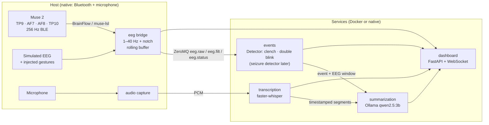

# Bayn

**A deliberate gesture on a Muse 2 headband starts a local pipeline: the event is tagged, the EEG around it is saved, live speech is transcribed with Whisper, and a small local LLM writes a short summary. Everything runs 100% offline.**

> [!WARNING]
> **Prototype for a hackathon demo. Not a medical device.** It does not detect seizures or any medical condition, and it must not be used for diagnosis, monitoring or treatment.


<!-- TODO(Phase 7): replace with a real screenshot / GIF of the demo -->

## Status

| Phase | Scope | State |
|---|---|---|
| 1 | Repo, simulated EEG, dashboard skeleton | ✅ done |
| 2 | Real Muse 2 (BrainFlow, muse-lsl fallback) | ⏳ next |
| 3 | Gesture trigger (jaw clench / double blink), calibration, events | ⬜ |
| 4 | Live Whisper transcription (English / Arabic / mixed) | ⬜ |
| 5 | Ollama summaries | ⬜ |
| 6 | Gesture tuning on the real headset | ⬜ |
| 7 | Docker Compose + docs polish | ⬜ |
| 8 | Full end-to-end test run (simulated and real) | ⬜ |

Details per phase: [docs/PROGRESS.md](docs/PROGRESS.md).

## How it works



- **One message bus (ZeroMQ, TCP).** Every component is a separate process, so it works the same natively and in Docker.
- **The trigger sits behind a `Detector` interface** (Phase 3). The jaw clench, the double blink, the manual button/hotkey and a future seizure model are interchangeable.
- **No hardware assumptions.** The mains notch defaults to `auto` (measures 50 vs 60 Hz). Whisper picks GPU or CPU at startup.

## Quickstart

Requires **Python 3.12+**. No headset or microphone is needed for the demo.

### Windows (PowerShell)
```powershell
.\scripts\bayn.ps1 setup     # creates .venv, installs pinned deps, runs the machine check
.\scripts\bayn.ps1 demo      # simulated EEG + scripted gestures, opens http://127.0.0.1:8080
```
If PowerShell blocks scripts: `powershell -ExecutionPolicy Bypass -File .\scripts\bayn.ps1 setup`

### macOS / Linux
```bash
make setup
make demo
```

### Without the helpers
```bash
python -m venv .venv && . .venv/bin/activate      # Windows: .venv\Scripts\activate
pip install -r requirements/dev.txt && pip install -e . --no-deps
python -m bayn.run --demo
```

Other commands: `test`, `doctor` (check a machine before a demo), `bridge`, `ui`, `clean`.

## Configuration

Settings live in [config/default.yaml](config/default.yaml). Override them per machine with `config/local.yaml` (gitignored) or with environment variables / `.env`:

```
BAYN_EEG__SOURCE=sim            # sim | muse | lsl
BAYN_EEG__NOTCH_HZ=auto         # auto | 50 | 60 | off
BAYN_UI__PORT=8080
```

## Muse 2 pairing notes

Full instructions arrive in Phase 2. Key points:
- **Do not pair the Muse in Windows Bluetooth settings.** BrainFlow connects to it directly over BLE. Turn the headset on and leave it in pairing mode (lights moving).
- Close the Muse phone app and turn off phone Bluetooth. The Muse accepts only one connection at a time.
- Wet the sensors slightly and check the per-channel quality chips on the dashboard.

## Project layout

```
config/          default.yaml (all tunables)
src/bayn/
  common/        config, ZeroMQ bus, message schemas
  eeg/           sources (simulated, Muse), streaming filters, ring buffer, quality, bridge
  events/        Detector interface + gesture detectors       (Phase 3)
  transcription/ faster-whisper live transcription            (Phase 4)
  summarization/ Ollama client + prompts                       (Phase 5)
  ui/            FastAPI server + static dashboard (no CDN, works offline)
  run.py         one-command launcher     doctor.py  machine check
scripts/         bayn.ps1 (Windows tasks), claude-session.ps1
tests/           pytest suite (runs without hardware)
docs/            progress log, images
```

## Privacy

Everything runs locally. No cloud APIs and no analytics. Model weights are downloaded once during setup (from Phase 4). After that the system runs with the network unplugged.

## License

[MIT](LICENSE)
